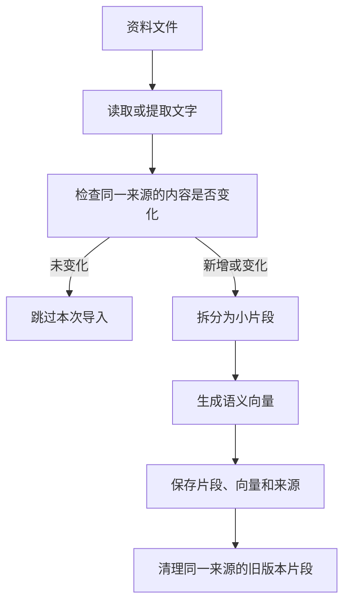
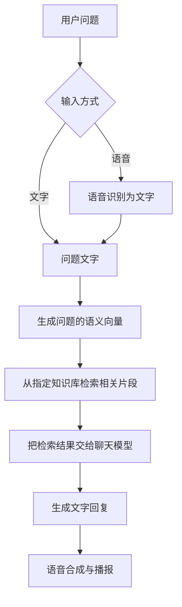

# RAG 文档检索

上一篇：[03-服务部署](03.server-development.md)<br />
下一篇：[05-xxx](05.xxx.md)
<hr />

RAG 可以理解为：**先查你提供的资料，再让小智参考资料回答。** 本文先介绍用途和流程，配置与代码放在最后的开发者附录中。

## 一、RAG 能帮你做什么

假设你有一份设备说明书，里面写着“长按配网键 5 秒进入配网模式”。用户问“小智，这台设备怎么重新连接 Wi-Fi？”，RAG 会查找相关说明，再交给聊天模型组织回答。

| 对比 | 普通问答 | 接入 RAG 后的问答 |
| --- | --- | --- |
| 回答参考 | 模型已有的知识和对话内容 | 在原有基础上，加入检索到的资料 |
| 专有设备问题 | 可能不清楚这台设备的具体操作 | 可以参考你导入的设备说明书 |
| 资料更新 | 模型不一定知道新的说明 | 重新导入后，可以检索新的内容 |
| 答案可靠性 | 仍需核对 | 仍需核对，找到资料不代表回答一定正确 |

RAG 适合设备说明书、常见问题、业务流程等文字资料。它不等于训练模型：项目把资料存入知识库，在回答时查找相关片段，而不是修改模型本身。

## 二、当前项目实现到哪一步

当前项目已有检索和导入相关代码，但示例服务默认没有启用完整 RAG 链路。

| 能力 | 当前实现 | 使用状态 |
| --- | --- | --- |
| 回答前检索 | 服务端将相关资料交给聊天模型 | 完成 RAG 配置、注册存储并导入资料后接入 |
| TXT、Markdown 导入 | 示例程序读取目录中的文字文件并建立索引 | 调用代码目前被注释，需要启用 |
| PDF、Word、Excel、CSV 解析 | 独立文档模块提取文字，再交给导入管线 | 示例服务没有引用该模块，需要额外接入 |
| 内存存储 | 示例项目提供内存向量存储 | 需要注册，重启后需重新导入 |
| Qdrant 存储 | 独立模块提供数据库读写与检索 | 需要部署 Qdrant、注册存储并初始化 |
| 内容更新 | 知识分析器跳过未变化的内容，替换已变化的内容 | 再次导入时执行，不会自动监控目录 |

> [!NOTE]
> 示例程序中的 `WithRagVectorStore(...)` 和 `BuildKnowledgeBase(...)` 调用目前被注释。`config_rag.json` 默认选择 `Qwen`，核心会进入 RAG 初始化；未注册存储或未准备资料目录时，初始化会失败。启用 RAG 需按附录完成接入，暂不使用时可删除 `SelectedSettings.RAG`。

## 三、资料如何进入知识库

导入就是把说明书整理成便于检索的小片段，并记录它们来自哪个文件。



**语义向量（Embedding）** 是一组代表文字含义的数字。它帮助系统找到意思接近的资料，即使问题和说明书使用的词不完全相同。

例如，“重新连接 Wi-Fi”和“进入配网模式”措辞不同，但系统可能找到它们之间的关联。**索引** 就是把文字片段、这些数字和来源信息一起保存，方便以后查询。

当前示例知识分析器先按段落整理文字，较长内容再拆分，相邻片段可保留一部分重叠文字，减少上下文被切断的影响。

重复导入时，系统比较同一来源的内容摘要，也就是用于判断内容是否变化的标记。未变化的内容可跳过；变化的内容先写入新片段，再清理旧片段。这个顺序不代表整个更新过程具有事务保证。

当前没有目录自动监控。修改文件后需要再次导入；删除原文件也不会自动删除知识库中的旧片段，需要开发者调用删除接口。内存存储重启后内容消失，下一次导入会重新建立索引。

## 四、小智如何参考资料回答



此流程以完成配置、存储注册和知识库导入为前提。RAG 在聊天模型回答前提供参考资料，语音识别和语音合成继续由原有会话链路处理。

检索会挑选与问题相近的片段，并可按最低相似度筛选。**相似度分数表示相关程度，不是答案正确率。** 系统找到了“配网”段落，也仍需确认它适用于用户所问的设备型号。

检索结果带有文件名称和来源标识，但不代表每次回复都会显示引用；来源标识也不一定是可打开的网页链接。当前核心代码没有额外保证“资料不足时一定拒答”。如需这类回答规则，应在提示词中明确要求，并通过实际问答验证。

## 五、准备资料与选择存储

### 支持哪些文件

“解析模块支持”表示已有提取文字的代码，不表示默认示例会自动导入该格式。

| 文件格式 | 示例默认导入路径 | 独立文档解析模块 | 注意事项 |
| --- | --- | --- | --- |
| TXT：`.txt` | 支持 | 支持 | 建议使用 UTF-8 编码 |
| Markdown：`.md`、`.markdown` | 支持 | 支持 | 作为文字读取，不按页面样式处理 |
| PDF：`.pdf` | 不支持 | 支持 | 提取已有文字，无扫描件 OCR（图片文字识别） |
| Word：`.docx` | 不支持 | 支持 | 提取正文段落文字，不保留完整页面样式 |
| Excel：`.xlsx` | 不支持 | 支持 | 按工作表和行提取单元格内容 |
| CSV：`.csv` | 不支持 | 支持 | 将每行的单元格内容整理成文字 |

旧版 `.doc`、`.xls` 没有对应解析器。纯图片和只有扫描图片的 PDF，需要先转成可提取的文字。

准备设备说明书时，建议写清设备型号、操作条件和完整步骤，把不同主题分成段落。表格中也应保留单位与字段含义，例如“配网键｜长按 5 秒”，方便片段单独被检索时仍能理解。

导入和查询都会调用 Embedding 服务。使用远程接口时，资料片段和问题会发送给该服务；检索出的文字还会提供给聊天模型。是否产生费用取决于所选服务。

### 内存还是 Qdrant

向量存储是保存资料片段及其语义向量的地方。Qdrant 是用于这类检索的独立数据库服务。

| 对比 | 示例内存存储 | Qdrant |
| --- | --- | --- |
| 保存位置 | 当前程序的内存 | 独立数据库服务 |
| 主服务重启后 | 资料索引消失，需要重新导入 | 数据可保留，需正确配置 Qdrant 的持久化存储 |
| 额外准备 | 注册示例存储并导入资料 | 部署数据库、注册存储、导入并初始化 |
| 适用场景 | 本地体验、小规模验证 | 需要保留索引的部署 |

存储方式由代码注册决定，当前不能只填写 `StoreType` 就切换。无论使用哪种存储，导入和查询都应使用同一个 Embedding 模型，并保持向量维度一致。

## 六、使用步骤与常见问题

当前启用 RAG 需要修改示例接入代码，建议由部署人员或开发者按附录操作。

1. **准备资料：** 先用一份 TXT 或 Markdown 设备说明书，放到可读取的目录。
2. **配置模型：** 保留现有聊天模型配置，另配置 Embedding 模型和 RAG 引用。
3. **注册存储：** 本地体验使用示例内存存储；Qdrant 需要另外接入。
4. **导入知识库：** 在服务运行前执行导入，让导入与查询使用相同的存储和知识库编号。
5. **验证问答：** 先问说明书明确记录的问题，再换一种说法提问，最后测试资料未涉及的问题。

例如，先问“配网键要按多久？”，再问“怎么重新连接 Wi-Fi？”，核对回复是否符合该设备说明书。资料未涉及的问题用于检查回答边界，不能预期系统必然拒答。

| 现象 | 优先检查 |
| --- | --- |
| 配了模型，回答仍像普通聊天 | 是否存在选中的 RAG 配置，是否启用了存储注册和导入调用 |
| 启动或导入失败 | 目录是否存在、文件是否有文字、模型配置是否完整、外部服务是否可访问 |
| 找不到说明书中的内容 | 是否导入到查询使用的知识库；导入和查询是否使用同一存储、同一 Embedding 模型 |
| 设置最低分数后没有命中 | 分数门槛是否过高，资料是否写清问题所需的内容 |
| 修改说明书后回答未更新 | 是否再次导入；修改后的文件是否仍有可提取的文字 |
| 删除说明书后仍能检索到 | 删除文件不会清理索引，需要调用存储删除接口 |
| 重启后找不到资料 | 内存存储需重新导入；Qdrant 存储实例需初始化，见附录 |
| 回复没有列出来源或答了资料外的问题 | 来源展示和资料不足时的回答规则需要提示词约束及实际验证 |

## 附录：开发者接入参考

以下片段按当前代码整理，外部 Embedding、聊天模型与 Qdrant 服务未在本文编写时进行端到端验证。基础部署见[服务部署](03.server-development.md)，模型字段见[配置文件参考](00.configuration-file.md)。

### A. 最小内存示例配置

RAG 配置单独放在 `Configs/config_rag.json` 中，主服务会随其他 `config_*.json` 分片一起加载。以下是最小示例，保留原有聊天、语音和其他配置文件。所有连接信息均为占位值，需要替换成实际 Embedding 服务配置。

```json
{
  "SelectedSettings": {
    "RAG": "Qwen"
  },
  "ConfiguredSettings": {
    "RAG": {
      "Qwen": {
        "BaseUrl": "https://your-embedding-service.example/v1/",
        "ApiKey": "your-api-key",
        "ModelName": "your-embedding-model",
        "DocumentDirectory": "./document",
        "KnowledgeBaseId": "sample-knowledge-base",
        "TopK": "5"
      }
    }
  }
}
```

`SelectedSettings.RAG` 选择 `ConfiguredSettings.RAG` 下的一份配置。每份配置同时包含向量模型连接信息和检索设置，核心检索与示例导入器都从 RAG 类别读取。示例文件提供 `Chatglm` 和 `Qwen`，默认选择 `Qwen`；RAG 配置不再需要 `Type` 或 `EmbeddingLLM`，也不再引用 LLM 类别。

`config_llm.json` 只保存聊天模型。LLM 和 RAG 都可以使用 `Qwen` 这个配置名，但分别表示聊天模型和向量模型，互不替代。

示例构建器将资料导入固定的 `sample-knowledge-base`，查询配置也必须使用该编号。`DocumentDirectory` 目前只在核心加载时检查目录是否存在，不会自动导入；导入目录由 `BuildKnowledgeBase(...)` 的参数决定，两处应指向同一目录。相对路径以程序当前工作目录为基准。

配置值使用字符串，与当前 `ConfiguredSettings` 的字典结构保持一致。示例不设置 `MinimumScore`，表示不限制最低分数；如需筛选，可添加字符串形式的数值，并用实际资料调整。

### B. 启用示例中的内存接入

在示例 `Program.cs` 中引入命名空间，并启用已有的存储注册调用：

```csharp
using XiaoZhi.Net.Sample.Server.RAG;

// 放在现有 Initialize(config) 之后、Build() 之前，保留其他注册。
serverBuilder.WithRagVectorStore(KnowledgeBaseBuilder.VectorStore);
```

在现有 `serverHost = serverBuilder.Build();` 之后、`RunAsync()` 之前启用导入：

```csharp
serverHost.BuildKnowledgeBase(config, Path.Combine(Environment.CurrentDirectory, "document"));
await serverHost.RunAsync();
```

先创建 `document` 目录并放入至少一份非空 TXT 或 Markdown 文件。此调用递归读取子目录，使用示例的同一内存存储建立索引；每次启动重新导入。当前示例导入不会处理 PDF、Word 或 Excel。

### C. 关键参数

| 位置与参数 | 默认值 | 含义与要求 |
| --- | --- | --- |
| `SelectedSettings.RAG` | 无 | 选择 RAG 配置，例如 `Qwen` |
| `RAG.<配置名>.BaseUrl / ApiKey / ModelName` | 无 | 均需非空；使用 OpenAI 兼容接口，模型应支持生成文本向量 |
| `RAG.<配置名>.DocumentDirectory` | 无 | 当前核心要求目录存在，即使使用 Qdrant 也会检查 |
| `RAG.<配置名>.KnowledgeBaseId` | `default` | 查询的知识库编号；使用当前构建器时填 `sample-knowledge-base` |
| `RAG.<配置名>.TopK` | `5` | 最多检索的片段数，不是文件数 |
| `RAG.<配置名>.MinimumScore` | 不限制 | 最低相似度，过高可能没有结果；不是正确率 |
| `KnowledgeAnalyzerConfig.ChunkSize` | `512` | 示例片段长度上限，单位为字符，不是模型 token |
| `KnowledgeAnalyzerConfig.ChunkOverlap` | `64` | 相邻片段的目标重叠字符数，实际可能更少，需小于片段长度 |
| `KnowledgeAnalyzerConfig.EmbeddingBatchSize` | `16` | 每批向量化的片段数，需大于 0 |

最后三个参数是示例代码中的 `KnowledgeAnalyzerConfig` 属性，当前构建器使用默认实例，不会自动从 RAG JSON 节点读取它们。

### D. Qdrant 与多格式导入

Qdrant 模块提供 `AddQdrantVectorStore(QdrantVectorStoreConfig)` 注册方法，在 `Build()` 之前调用。例如：

```csharp
using XiaoZhi.Net.Server.RAG.Abstractions;
using XiaoZhi.Net.Server.RAG.Qdrant;

serverBuilder.AddQdrantVectorStore(new QdrantVectorStoreConfig
{
    Host = "localhost",
    Port = 6334,
    UseTls = false,
    CollectionName = "xiaozhi_knowledge"
});
```

默认使用 gRPC 端口 `6334`；`ApiKey` 默认不设置，按数据库部署要求提供。此片段仅注册存储，不包含导入和初始化。不要同时继续使用示例的固定内存构建器导入资料，否则查询和导入会落到不同存储。

使用 Qdrant 时，开发者需从服务容器取得同一个 `IVectorStore`，让知识分析器向其写入，并保持知识库编号与查询配置一致。写入新内容时，示例分析器会按向量维度调用 `EnsureInitializedAsync(...)`。

**重启后仍需初始化当前存储实例。** Qdrant 实现把向量维度保存在实例内；未初始化时检索返回空结果。即使数据库已有资料，也需要使用匹配的维度调用 `EnsureInitializedAsync(...)`。重复导入若因内容未变化而跳过，不会执行这一步。已有集合的向量维度还需与所选模型匹配；切换模型时应重建索引，不能只凭维度相同复用旧向量。

多格式导入需要额外引用 `XiaoZhi.Net.Server.RAG.Documentation`，提供 `IKnowledgeAnalyzer` 实现并让它使用查询侧的同一存储。该模块在 `XiaoZhi.Net.Server.RAG.Documentation.Extensions` 命名空间下提供的注册方法当前也叫 `AddQdrantVectorStore`，但参数为 `IKnowledgeAnalyzer`；这个重载注册的是文档解析器和导入管线，不是 Qdrant 数据库。

注册后取得 `IKnowledgeImportPipeline`，调用 `ImportFileAsync(...)` 或 `ImportDirectoryAsync(...)`，传入 Embedding 生成器和知识库编号。目录导入会递归处理文件并返回成功、跳过、失败或不支持的结果；扫描件无法提取文字时会报告失败。示例中的多格式导入调用目前也被注释，仅取消注释不足以完成模块引用与服务注册。

### E. 模块职责与代码入口

| 模块或入口 | 职责 |
| --- | --- |
| [RAG.Abstractions](../src/rag/XiaoZhi.Net.Server.RAG.Abstractions) | `IVectorStore` 存储契约、`IKnowledgeAnalyzer` 知识分析契约、`IKnowledgeImportPipeline` 导入契约及数据模型 |
| [RAG.Documentation](../src/rag/XiaoZhi.Net.Server.RAG.Documentation) | 多格式文字提取和文件导入管线；具体知识分析器由使用方提供 |
| [RAG.Qdrant](../src/rag/XiaoZhi.Net.Server.RAG.Qdrant) | Qdrant 的初始化、写入、删除与相似度检索 |
| [示例 RAG 目录](../demo/XiaoZhi.Net.Sample.Server/RAG) | `KnowledgeBaseBuilder`、`KnowledgeAnalyzer` 和 `InMemoryVectorStore`；这些实现位于示例项目 |
| [ResourceManager](../src/server/XiaoZhi.Net.Server/Server/Management/ResourceManager.cs) | 判断是否配置 RAG，注册 Embedding 生成器并加载 RAG 资源 |
| [DefaultRag](../src/server/XiaoZhi.Net.Server/Server/Resources/Rag/DefaultRag.cs) | 将问题向量化、检索资料，并包装为 `TextSearchProvider` 上下文提供器 |
| [ChatAgent](../src/server/XiaoZhi.Net.Server/Server/Providers/LLM/Agents/ChatAgent.cs) | RAG 就绪后接入上下文提供器，在模型回答前检索 |

服务端运行时只引用 RAG 抽象，不内置示例内存存储，也不直接引用文档解析模块。自定义存储可实现 `IVectorStore`，通过 `WithRagVectorStore<TVectorStore>()` 或实例重载注册。

独立体验可参考 [Sample20_RAG](../tests/XiaoZhi.Net.Test/OtherSamples/Sample20_RAG.cs)。它演示内存检索和回答，但使用自己的分段参数与提示词，不代表示例主服务已经启用相同配置。

<hr />

上一篇：[03-服务部署](03.server-development.md)<br />
下一篇：[05-xxx](05.xxx.md)