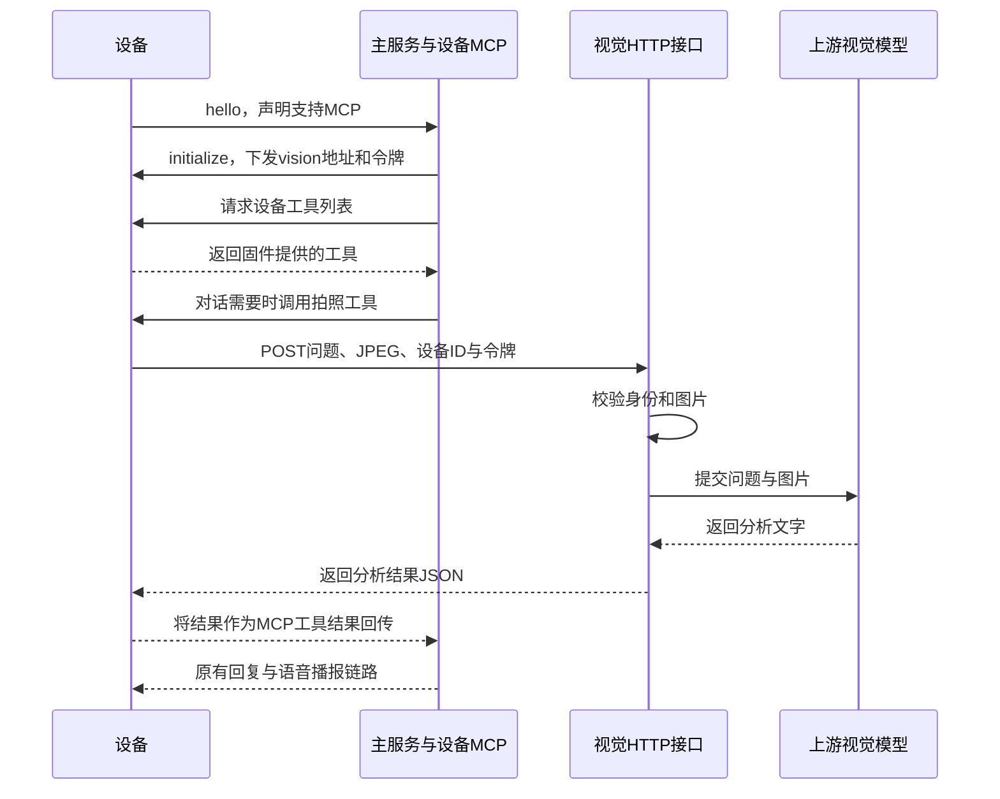
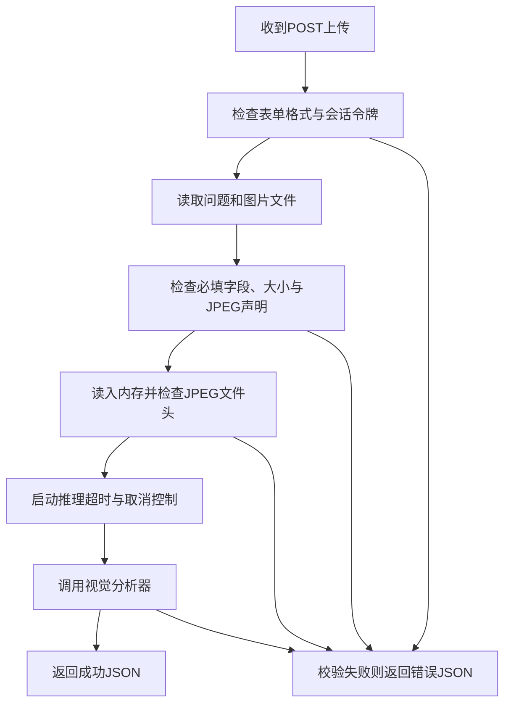

# 视觉分析

上一篇：[04-RAG 文档检索](04.rag.md)<br />
下一篇：[06-聊天记忆保存](06.chat-memory.md)
<hr />

视觉分析可以理解为：**设备拍一张照片，把照片和问题交给能看图的模型，再把分析结果带回对话。** 例如，用户问“小智，帮我看看桌上有什么”，设备拍照上传，视觉模型返回“桌上有一个杯子和一本书”。

本文按“准备设备与模型 → 配置服务 → 验证上传 → 理解内部流程”的顺序说明。内容以当前代码为准，设备拍照工具的名称与行为由固件决定。

## 一、当前支持什么

| 能力 | 当前实现 | 使用前提或限制 |
| --- | --- | --- |
| 图片分析 | 将问题和图片一起发送给 OpenAI 兼容的视觉语言模型 | 模型与接口必须支持图片输入 |
| 设备上传 | 独立 HTTP 接口接收一张 JPEG 图片和一个问题 | 需要有效的设备会话上传令牌 |
| 自动下发上传信息 | 通过设备 MCP 初始化下发上传地址与令牌 | 设备需要声明支持 MCP，并按固件约定使用视觉能力 |
| 对话中拍照 | 已发现的设备拍照工具可作为 MCP 工具参与对话 | 固件需提供对应工具，服务端需启用工具调用 |
| 语音回复 | 设备将分析结果作为工具结果返回后，可继续原有回复与播报链路 | 视觉 HTTP 接口本身只返回文字 JSON |
| 功能启用 | 示例已经给出启用视觉模块的代码 | `Program.cs` 中的 `WithVision(...)` |

当前处理单张图片，不提供视频流分析、图片知识库或跨请求图片记忆。它与 [RAG 文档检索](04.rag.md) 是独立能力：RAG 查文字资料，视觉模块调用能理解图片的模型。

## 二、配置前需要准备什么

| 准备项 | 要确认的内容 |
| --- | --- |
| 设备 | 有可用摄像头，固件支持 MCP、视觉能力下发以及 JPEG 上传 |
| 主服务 | 原有设备连接和对话链路可用，额外开放视觉 HTTP 端口 |
| 视觉模型 | 有支持图片输入的模型名称、OpenAI 兼容 API 地址和 API Key |
| 网络 | 设备能访问图片上传地址，服务器能访问模型 API |
| 工具调用 | 希望通过自然语言触发拍照时，需启用 `FunctionCall` 或 `IntentLlm` 模式，并发现设备拍照工具 |

仅有摄像头不代表固件支持本项目的上传约定。服务端也不会主动为设备新增一个固定名称的拍照工具；实际工具以设备返回的工具列表为准。

### 分清三个地址

| 配置项 | 谁使用 | 示例 | 作用 |
| --- | --- | --- | --- |
| `ListenUrl` | 服务器 | `http://0.0.0.0:8003` | 在本机哪个地址和端口监听视觉 HTTP 请求 |
| `PublicExplainUrl` | 设备 | `http://192.168.1.100:8003/mcp/vision/explain` | 设备实际上传图片的完整地址，必须包含路径 |
| `Model.Endpoint` | 服务器 | `https://your-model-service.example/v1/` | 调用视觉模型的 API 基地址 |

这里假设服务器局域网 IP 是 `192.168.1.100`，设备与服务器在同一可互通网络。请替换成实际地址。

`0.0.0.0` 表示监听本机网络接口，不能作为设备的上传地址。设备上的 `127.0.0.1` 指向设备自身。跨网络部署时，应填写设备可访问的域名或地址，并配置对应的端口转发或反向代理。

默认本地路由是 `/mcp/vision/explain`。直连时，`PublicExplainUrl` 的路径应与 `ExplainPath` 相同；使用反向代理时，外部路径需正确转发到本地路由。程序会检查地址格式，但不会自动检查设备是否能访问，也不会自动比较两处路径。

### 分清三种凭据

| 凭据 | 用途 | 配置或来源 |
| --- | --- | --- |
| 模型 API Key | 服务器调用上游视觉模型 | `Model.ApiKey`，由模型服务提供 |
| 上传令牌签名密钥 | 服务器签发并校验设备上传令牌 | `UploadTokenSigningKey`，自行准备至少 32 个 UTF-8 字节的随机密钥 |
| 设备上传令牌 | 设备向视觉 HTTP 接口证明上传身份 | 服务端在设备 MCP 初始化时生成并下发 |

设备上传的是会话令牌，不需要拿到模型 API Key 或签名密钥。WebSocket 登录鉴权与视觉上传鉴权也各有用途，不能把登录令牌直接当作视觉上传令牌。

## 三、配置与启用步骤

### 1. 确认模块引用

示例 [XiaoZhi.Net.Sample.Server](../demo/XiaoZhi.Net.Sample.Server/XiaoZhi.Net.Sample.Server.csproj) 已引用 `XiaoZhi.Net.Server.Vision`。自己的宿主项目需添加此模块的引用；普通主服务项目不会自动启用视觉功能。

当前视觉模块通过 `WithVision(...)` 配置，没有内置 `config_vision.json`、`SelectedSettings.Vision` 或 `ConfiguredSettings.Vision` 的绑定逻辑。仅创建一个 JSON 文件不会自动注册视觉接口。如需自行从配置文件读取参数，还要在宿主代码中读取并传给 `WithVision(...)`。

### 2. 准备凭据

以下示例从环境变量读取签名密钥和模型 API Key。变量名称是此示例的约定，视觉模块不会自动读取它们。

Windows PowerShell 中可以先设置：

```powershell
# 为当前启动过程生成随机签名密钥，不输出密钥内容。
$visionSigningBytes = New-Object byte[] 32
$visionRandom = [System.Security.Cryptography.RandomNumberGenerator]::Create()
$visionRandom.GetBytes($visionSigningBytes)
$visionRandom.Dispose()
$env:XIAOZHI_VISION_SIGNING_KEY = [Convert]::ToBase64String($visionSigningBytes)
$env:XIAOZHI_VISION_API_KEY = 'replace-with-your-model-api-key'
```

将第二行占位值替换成实际模型 API Key，并从同一终端启动服务。也可以通过部署环境注入这两个变量。签名密钥在重新生成或主服务重启后，旧设备令牌不能继续使用，设备应重新连接获取新令牌。

### 3. 启用 WithVision

在示例 [Program.cs](../demo/XiaoZhi.Net.Sample.Server/Program.cs) 中引入扩展命名空间，并在现有 `Initialize(config)` 之后、`Build()` 之前调用：

```csharp
using XiaoZhi.Net.Server.Vision.Extensions;

serverBuilder.WithVision(options =>
{
    options.ListenUrl = "http://0.0.0.0:8003";
    options.ExplainPath = "/mcp/vision/explain";
    options.PublicExplainUrl = "http://192.168.1.100:8003/mcp/vision/explain";
    options.UploadTokenSigningKey = Environment.GetEnvironmentVariable("XIAOZHI_VISION_SIGNING_KEY")
        ?? throw new InvalidOperationException("请设置 XIAOZHI_VISION_SIGNING_KEY。");
    options.MaxImageBytes = 5 * 1024 * 1024;
    options.RequestTimeout = TimeSpan.FromSeconds(60);

    options.Model.Endpoint = "https://your-model-service.example/v1/";
    options.Model.ApiKey = Environment.GetEnvironmentVariable("XIAOZHI_VISION_API_KEY")
        ?? throw new InvalidOperationException("请设置 XIAOZHI_VISION_API_KEY。");
    options.Model.ModelName = "your-vision-model";
    options.Model.ResponseInstruction = "请使用中文简洁描述图片内容。";
});
```

替换 IP、模型地址和模型名称，保留现有其他注册与配置。示例已经有被注释的 `WithVision(...)` 调用，可按上面的内容启用；同一个构建器只能调用一次，不要同时保留两份调用。

`Model.Endpoint` 填写模型服务的 API 基地址，而不是本项目的图片上传地址。`Model.ModelName` 必须是支持图片输入的视觉模型；聊天模型或 Embedding 模型的名称不能因为来自同一家厂商就直接复用。

这个调用会在**同一个主服务进程**中增加 ASP.NET Core / Kestrel HTTP 监听，以及视觉分析器和设备能力下发服务。它不是额外启动一个独立视觉程序，也不会更改设备原有的 WebSocket 连接地址。

### 4. 配置设备与工具调用

设备发送的 `hello` 需声明支持 MCP，例如其中包含：

```json
{
  "type": "hello",
  "features": {
    "mcp": true
  }
}
```

这只是握手相关字段示例，固件还应按设备协议发送其他必要字段。声明 `mcp: true` 也不等于设备一定支持摄像头，应继续确认其工具列表和视觉上传实现。

使用默认空 `McpSettings` 时，服务端走设备 MCP 路径。已有自定义 MCP 配置时，应确认包含并正常构建设备 MCP 客户端，不能只连接外部工具服务。

如果希望说“小智，拍张照片看看”来触发工具，`config_intent.json` 中应选择已有的 `FunctionCall` 或 `IntentLlm` 模式。`None` 模式不会在对话中调用工具。`FunctionCall` 要求主聊天模型支持工具调用；`IntentLlm` 则使用配置的意图模型识别工具。具体字段见 [配置文件参考](00.configuration-file.md)。

HTTP 接口启用后，设备应重新连接，让本次 MCP 初始化取得最新上传地址和令牌。修改上传路径、地址或模型选项后，也应重启服务并重新验证设备连接。

## 四、配置字段参考

### 服务、上传与鉴权

以下是 `VisionServerOptions` 的属性，不是目前可自动绑定的 JSON 字段。

| 属性 | 默认值 | 要求与含义 |
| --- | --- | --- |
| `ListenUrl` | `http://0.0.0.0:8003` | HTTP / HTTPS 绝对地址；实际端口还需能正常绑定 |
| `PublicExplainUrl` | 空 | 必填，设备可访问的完整 HTTP / HTTPS 上传地址，包含路径 |
| `ExplainPath` | `/mcp/vision/explain` | 本地路由，必须非空并以 `/` 开头 |
| `UploadTokenSigningKey` | 空 | UTF-8 编码后至少 32 字节，用于设备会话上传令牌的签名 |
| `MaxImageBytes` | `5 * 1024 * 1024` | 图片大小上限，默认 5 MiB，必须大于 0 |
| `RequestTimeout` | 60 秒 | 模型推理超时，必须大于 0；从图片读取与校验完成后开始计时 |
| `Model` | 默认选项实例 | 上游模型配置，字段见下表 |

设置 HTTPS 监听还需要宿主的证书配置；仅把地址改成 `https://` 不会自动提供证书。也可以由反向代理提供外部 HTTPS，再转发到本地 HTTP。代理、HTTP 服务和模型提供方的上传限制需同时满足，增大 `MaxImageBytes` 不会自动调整它们的限制。

### 模型配置

| `VisionModelOptions` 属性 | 默认值 | 要求与含义 |
| --- | --- | --- |
| `Endpoint` | 空 | 必填，OpenAI 兼容 API 的 HTTP / HTTPS 绝对地址 |
| `ApiKey` | 空 | 必填，上游模型 API Key |
| `ModelName` | 空 | 必填，支持图片输入的模型名称 |
| `ResponseInstruction` | `请使用中文简洁描述图片内容。` | 追加在设备问题后面的文字要求；为空或空白时仅使用设备问题 |

`WithVision(...)` 调用时检查地址格式、签名密钥长度、必要模型字段、图片大小上限和推理超时。它不会提前验证 API Key 是否有效，也不会验证模型是否真的能看图；这些需要实际请求确认。

## 五、内部如何工作

### 1. 下发图片上传能力

MCP 可以理解为设备与服务器约定的一种工具交互方式：服务器告诉设备可用能力，设备提供它能执行的工具。

设备的正常会话初始化完成且声明支持 MCP 后，`ProviderManager` 构建设备 MCP 客户端。视觉模块的 `VisionMcpCapabilityContributor` 为这个设备会话签发令牌，并把以下片段加入 MCP `initialize` 请求的 `params.capabilities`：

```json
{
  "vision": {
    "url": "http://192.168.1.100:8003/mcp/vision/explain",
    "token": "<server-issued-session-token>"
  }
}
```

这里的 `url` 来自 `PublicExplainUrl`，`token` 由服务端生成。该片段是能力说明，不是模型配置，也不是要求用户手工填写的固定令牌。

下面是一种通过设备工具拍照的典型流程；能否执行最后的工具结果回传，取决于设备固件是否实现该约定。



服务端发现工具后，由所选的工具调用模式决定是否调用。不能仅因开启视觉接口，就保证每个涉及图片的问题都会触发拍照。

### 2. 会话令牌如何校验

令牌包含随机标识、设备 ID 和会话 ID，服务端用 HMAC-SHA256 为载荷签名。可以把签名理解为“只有持有签名密钥的服务器才能制作的校验标记”。签名用于防止内容被篡改，不等于加密图片或网络传输。

上传时，接口检查签名、服务端当前有效令牌记录，以及请求中的 `Device-Id` 是否与令牌绑定的设备一致。仅有一个格式相似的字符串，或把其他设备的令牌拿来使用，都不能通过校验。

设备会话释放时，设备 MCP 客户端释放视觉能力并撤销令牌；主服务重启也会丢失内存中的有效令牌记录。当前没有固定分钟数的过期配置，令牌有效性由活动会话的记录控制，同一有效会话可多次上传。

撤销阻止后续请求通过校验，但当前代码不会因为 WebSocket 断开就自动取消已经通过鉴权的 HTTP 推理。该请求的取消来自 HTTP 客户端断开或模型推理超时。

### 3. HTTP 接口如何处理图片



接口要求图片声明为 `image/jpeg`，并检查文件起始字节是否为 JPEG 标记。这不是完整图片解码验证，模型仍可能拒绝损坏的图片。当前图片读入内存后提交给模型，模块没有将上传文件写入本地目录的保存流程。

### 4. 问题和图片如何交给模型

默认 `OpenAICompatibleVisionAnalyzer` 将一次请求组织为一条用户消息：

| 消息内容 | 来源 |
| --- | --- |
| 问题文字 | 上传表单的 `question` |
| 补充回复要求 | `Model.ResponseInstruction`，追加在问题之后，不是独立系统提示词 |
| 图片内容 | 上传的 JPEG 字节，通过 SDK 的图片内容类型提交 |

它调用 `IChatClient.GetResponseAsync(...)`，等待完整文字结果，再返回 HTTP 响应。当前不是逐字流式返回，不加入设备的完整聊天历史，也不直接进行工具调用。模型返回空文字时按上游失败处理。

因此，视觉模型负责“看图并回答这个问题”，后续是否润色、转成语音，由设备回传和已有会话链路继续处理。模型 API Key 只用于服务器到上游模型这一段。

## 六、如何验证配置

### 第一步：检查HTTP接口可访问

主服务启动后，在服务器本机执行：

```powershell
Invoke-WebRequest -Uri 'http://127.0.0.1:8003/mcp/vision/explain'
```

默认 GET 响应正文为：

```text
MCP Vision endpoint is running.
```

再从与设备同网络的另一台机器访问 `PublicExplainUrl`。GET 不需要令牌，也不会调用视觉模型，所以成功只能证明路由可访问，不能证明模型凭据、图片上传或设备能力已经可用。

### 第二步：检查设备初始化

让设备重新连接，确认声明 `features.mcp = true`，并通过固件调试信息确认收到了 `vision` 能力和拍照工具已被发现。检查时不要把完整令牌或模型密钥复制到公开日志。

主服务调试日志可能包含下发的协议消息，应按含有会话凭据的信息处理。HTTP GET 正常但没有 `vision` 能力时，优先核对是否调用 `WithVision(...)`、设备是否支持 MCP，以及自定义 MCP 配置是否构建了设备客户端。

### 第三步：测试一次真实图片请求

设备需使用当前会话下发的令牌，并保持该会话有效。下面仅是 HTTP 协议示例，所有尖括号内容都需替换；也可用固件实际上传完成验证。

```powershell
curl.exe --request POST `
  --header "Authorization: Bearer <active-session-token>" `
  --header "Device-Id: <matching-device-id>" `
  --form "question=这张图片里有什么？" `
  --form "file=@C:/path/to/test.jpg;type=image/jpeg" `
  "http://192.168.1.100:8003/mcp/vision/explain"
```

不要自行设置一个没有正确 boundary 的 `Content-Type` 请求头；`curl.exe --form` 会生成正确的表单格式。示例不是匿名上传接口，也不使用模型 API Key 作为 Bearer 令牌。

| 请求部分 | 字段 | 要求 |
| --- | --- | --- |
| HTTP 方法 | `POST` | 路径与 `ExplainPath` 对应 |
| 请求头 | `Authorization` | `Bearer <设备会话上传令牌>` |
| 请求头 | `Device-Id` | 与令牌绑定的设备 ID 一致 |
| 表单 | `question` | 非空问题文字 |
| 表单文件 | `file` | 非空 JPEG，声明为 `image/jpeg`，不超过图片大小上限 |

当前 POST 请求必须使用表单格式；仅上传 JSON、图片 URL 或 Base64 字符串没有对应接收逻辑。`Client-Id` 被允许作为跨域请求头，但当前视觉处理没有使用它进行鉴权。

成功响应是 HTTP 200，例如：

```json
{
  "success": true,
  "action": "RESPONSE",
  "response": "桌上有一个杯子和一本书。"
}
```

最后通过自然语言触发设备拍照，核对 HTTP 分析、MCP 工具结果回传与语音回复是否都完成。只测试 HTTP 成功，不能代替这一步设备联动测试。

## 七、失败响应与排查

错误响应统一包含 `success: false` 和 `message`，HTTP 状态码说明失败位置：

| 状态或现象 | 当前含义 | 优先检查 |
| --- | --- | --- |
| 启动报地址或参数错误 | `WithVision(...)` 的配置校验未通过 | 地址是否为HTTP / HTTPS绝对地址，密钥是否至少32字节，模型字段是否完整 |
| 启动报重复注册 | 同一个构建器调用了两次 `WithVision(...)` | 是否同时取消注释旧调用并新增调用 |
| GET无法访问 | 端口、路由或网络没有打通 | 服务是否启动、监听端口是否被占用、代理与防火墙是否放行 |
| `400` | 表单格式、必填字段、图片类型或文件头不符合要求 | 使用 `multipart/form-data`，填写 `question` 和 `file`，上传有效JPEG |
| `401` | 令牌缺失、无效、已撤销，或设备ID不匹配 | 使用当前会话令牌与绑定设备ID，重连后不要继续使用旧令牌 |
| `413` | 图片超过上限，或HTTP解析阶段报告请求过大 | 压缩图片，核对模块、HTTP宿主及代理的限制 |
| `502` | 上游调用异常、模型返回空文字，或其他未单独处理的异常 | 模型地址、API Key、视觉模型能力和服务端错误日志 |
| `504` | HTTP连接仍在，但视觉推理超过 `RequestTimeout` | 上游耗时、网络及超时设置 |
| 接口正常但不会拍照 | 没有可调用的拍照工具，或工具调用模式不匹配 | 固件、设备工具列表、Intent模式与模型工具调用能力 |
| 已上传但没有语音 | HTTP返回不等于已完成会话工具回传 | 设备是否将 `response` 带回MCP工具结果，后续回复链路是否正常 |

HTTP 客户端中途断开时，请求会取消，接口不再保证返回一个可读取的 JSON 响应。设备摄像头、上传、HTTP推理及对话工具等待可能各有超时；增大 `RequestTimeout` 不会自动延长其他环节。当前通用 MCP 工具调用的默认等待为30秒，而视觉推理默认上限为60秒，较慢的完整拍照流程需要结合客户端与调用方验证。

接口还支持 `OPTIONS`，正常返回204用于跨域预检。当前跨域配置允许任意来源，POST仍需校验令牌；跨域放行不代表浏览器或其他客户端可以匿名调用模型。

## 八、实现入口与扩展边界

| 模块或源码 | 职责 |
| --- | --- |
| [Vision.Abstractions](../src/vision/XiaoZhi.Net.Server.Vision.Abstractions) | 公开选项、`VisionAnalysisRequest` 和 `IVisionAnalyzer` 契约 |
| [VisionServerBuilderExtensions](../src/vision/XiaoZhi.Net.Server.Vision/Extensions/VisionServerBuilderExtensions.cs) | 校验配置、注册服务、增加HTTP监听与路由 |
| [VisionMcpCapabilityContributor](../src/vision/XiaoZhi.Net.Server.Vision/Services/VisionMcpCapabilityContributor.cs) | 为设备会话下发视觉地址和令牌 |
| [VisionUploadTokenService](../src/vision/XiaoZhi.Net.Server.Vision/Services/VisionUploadTokenService.cs) | 签发、校验及撤销设备会话令牌 |
| [VisionEndpoint](../src/vision/XiaoZhi.Net.Server.Vision/VisionEndpoint.cs) | 上传校验、推理超时和HTTP响应 |
| [OpenAICompatibleVisionAnalyzer](../src/vision/XiaoZhi.Net.Server.Vision/Services/OpenAICompatibleVisionAnalyzer.cs) | 将问题与图片组织为用户消息并调用上游模型 |
| [DeviceMcpClient](../src/server/XiaoZhi.Net.Server/Server/Providers/MCP/DeviceMcp/DeviceMcpClient.cs) | 合并设备能力、发送MCP初始化和发现设备工具，会话释放时撤销能力 |

设备协议和会话由主服务管理，上传、令牌及模型调用由可选视觉模块管理。`IVisionAnalyzer` 是接收问题与图片、返回分析文字的契约，宿主可提供自己的实现，并在 `WithVision(...)` 注册后替换该服务；仍应保留HTTP校验与会话令牌流程，不要直接把上游模型凭据下发给设备。

图片会发送给配置的上游模型服务，是否计费及是否保留数据取决于服务提供方。模型描述也可能出错，需用清晰照片与明确问题验证结果。本文完成了源码与接口对应检查，未使用真实设备、实际模型凭据或外部服务执行端到端验证。

<hr />

上一篇：[04-RAG 文档检索](04.rag.md)<br />
下一篇：[06-聊天记忆保存](06.chat-memory.md)
