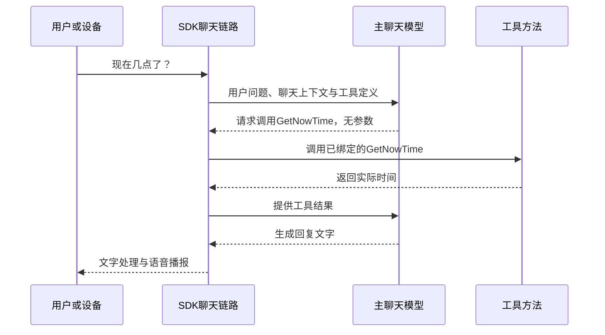
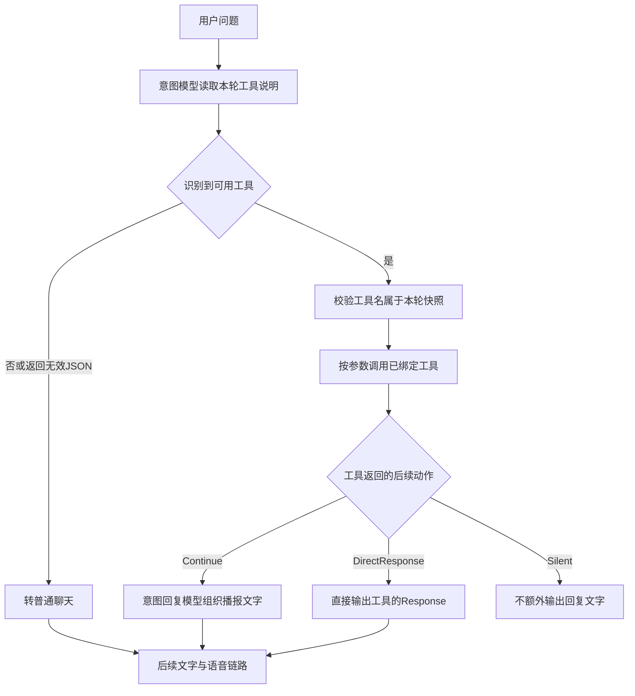

# Function Tool 扩展

上一篇：[06-聊天记忆保存](06.chat-memory.md)<br />
<hr />

Function Tool 可以理解为：**把程序已经会做的事情，整理成模型能选择的工具。模型决定需要什么，服务器执行操作，再把结果带回对话。**

例如，用户说“小智，现在几点了”，模型可以选择查询时间工具；用户说“暂停音乐”，服务器可以操作当前设备的播放器。模型负责理解语言，工具负责查询数据或执行操作。

本文先说明概念与调用过程，再介绍示例项目中的五类工具，最后说明如何新增工具、控制回复方式和验证效果。内容以当前代码为准。

## 一、什么是 Function Tool

LLM 是大语言模型，擅长理解和生成文字。它可以解释“怎样暂停音乐”，但只靠生成文字不会改变播放器状态。Function Tool 则是一个可调用的程序方法，可以真正读取时间、查询业务服务或操作播放器。

| 用户需求 | 只让模型生成文字 | 配合已接入的工具 |
| --- | --- | --- |
| “现在几点了？” | 不能仅凭模型知识保证当前时间准确 | 程序读取服务器时间再返回 |
| “杭州现在什么天气？” | 不能仅凭模型知识保证实时天气准确 | 可查询天气服务；当前示例仅返回模拟天气 |
| “暂停音乐” | 可以回答暂停的说明 | 调用播放器的暂停方法 |
| “说慢一点” | 可以改变文字表达 | 工具可修改当前会话支持的 TTS 语速预设 |

工具不会训练模型，也不要求模型能读懂项目的 C# 源码。服务器向模型提供的是工具名称、用途和参数说明；实际方法仍在程序或对应设备、远程工具服务中执行。

| 信息 | 以天气工具为例 | 谁负责 |
| --- | --- | --- |
| 工具名称 | `GetWeatherInfo` | 开发者定义，SDK 从方法名提取 |
| 用途说明 | 根据城市名称查询天气 | 开发者用 `Description` 描述 |
| 参数 | `city`，城市名称 | 模型从用户问题中选择，程序再检查是否可用 |
| 实际执行 | 查询服务，或示例中的模拟逻辑 | 工具代码 |
| 返回结果 | 天气文字或结构化数据 | 工具代码提供，后续链路决定如何回复 |

模型说“已完成”不等于工具已经执行。应结合工具日志、返回结果和实际状态验证。注册工具也不保证模型每次都会选择它。

## 二、LLM 怎样调用工具

### 1. 先让模型知道有哪些工具

启动时，`FunctionToolManager` 读取已注册工具类的方法信息。客户端连接后，SDK 将全局工具与本次会话工具绑定到该会话的 `FunctionToolsContext`。

SDK 使用 `AIFunctionFactory` 将方法包装成 `AIFunction`。可以把它理解为“带有名称、参数说明和执行入口的工具包装”。参数类型、说明及必填情况会形成参数结构说明，供模型使用。


除了本文介绍的 C# 工具，已接入的 MCP 工具和 IoT 能力也可以加入同一会话工具集合。MCP 是与设备或外部工具服务交互的一种协议；它与本地 C# 方法的执行位置不同，但都可以作为模型可选择的能力。

### 2. 模型提出调用，程序执行

下面是 `FunctionCall` 模式的典型过程：



模型不会直接执行 C#，也不会把生成的一段任意代码交给服务器运行。SDK 根据工具调用信息，调用已经注册并绑定的执行入口。

实际调用期间，工具可能失败，模型也可能不选择工具。需要查询或操作真实业务时，应在工具内检查参数、业务权限和执行结果，不能只靠描述文字约束行为。

## 三、当前项目的三种调用模式

模式由 `SelectedSettings.Intent` 选中一份配置，再由该配置的 `Type` 决定。选择模式不会自动注册工具。

| 模式 | 谁选择工具 | 执行流程 | 模型要求 |
| --- | --- | --- | --- |
| `None` | 不进行工具选择与执行 | 普通聊天；可把已注册能力的文字描述提供给聊天模型 | 聊天模型可用 |
| `FunctionCall` | 主聊天模型 | 提交工具定义，模型返回工具调用，SDK 执行后继续生成回复 | 主聊天模型及接口支持工具调用 |
| `IntentLlm` | 单独配置的意图模型 | 识别一个工具和参数，SDK 调用，再按结果动作回复；未命中则转普通聊天 | 意图模型能按要求输出结构化 JSON |

当前示例的 `config_intent.json` 选择 `IntentLlm`，其 `LLM` 引用 `Qwen`。实际部署还需考虑环境覆盖配置，以最终加载结果为准。

### FunctionCall：主模型选择工具

`ChatAgent` 在此模式下启用 `ChatToolMode.Auto`，`FunctionToolsContextProvider` 提供当前工具快照。`UseFunctionInvocation(...)` 负责处理模型返回的函数调用、执行工具并继续模型交互。

当前 `MaximumIterationsPerRequest` 设置为 5，用来限制一次请求的函数调用循环。它不是会话一共只能使用五个工具，也不等于恰好允许五次方法执行。模型可以在一轮中先查询列表、再发起后续操作，但仍取决于模型能力与循环限制。

### IntentLlm：先识别，再执行



`IntentDetectionAgent` 根据本轮工具列表输出工具名称和参数，并检查工具名是否存在。`FunctionCallAgent` 使用已解析的注册信息调用 `AIFunction.InvokeAsync(...)`。不是拿模型生成的名字去反射调用任意方法。

当前意图提示词要求一次只选一个主要工具，没有实现 `FunctionCall` 那样的多步自动调用循环。例如，“先列出歌曲再播放一首”是否能直接完成，不能仅靠工具描述保证。

普通 JSON 格式错误或未知工具名会回退到普通聊天；工具执行本身抛出异常时，不能保证仍能正常生成成功回复。当前意图识别也没有直接加载全部聊天历史和跨会话记忆，相关边界见 [聊天记忆保存](06.chat-memory.md)。

### 配置示例

以下是 `config_intent.json` 的相关结构，合并到现有配置中使用：

```json
{
  "SelectedSettings": {
    "Intent": "FunctionCall"
  },
  "ConfiguredSettings": {
    "Intent": {
      "None": {
        "Type": "None"
      },
      "FunctionCall": {
        "Type": "FunctionCall"
      },
      "IntentLlm": {
        "Type": "IntentLlm",
        "LLM": "Qwen"
      }
    }
  }
}
```

要使用意图模型，将选中值改为 `IntentLlm`，并确保 `Qwen` 是已有的 LLM 配置键；它同时用于意图识别和工具结果的生成回复，可以与主聊天模型不同。模型连接配置见 [配置文件参考](00.configuration-file.md#intent意图识别与工具调用)。

## 四、示例项目中的工具有什么作用

[Program.cs](../demo/XiaoZhi.Net.Sample.Server/Program.cs) 当前注册了五个工具类，共十个工具方法：

| 工具类 | 注册方式 | 用户可以尝试 | 实现范围 |
| --- | --- | --- | --- |
| `GetTime` | 全局工具 | “现在几点了？” | 读取服务器本地时间 |
| `GetWeather` | 会话工具 | “杭州现在天气怎么样？” | 返回固定晴天、25°C的模拟文字，没有调用天气接口 |
| `MusicPlayer` | 会话工具 | “有什么歌？”“播放音乐”“暂停” | 操作服务端目录中的音乐及当前会话播放器 |
| `ExitConversationFunctionTool` | 会话工具 | “先聊到这，再见” | 请求在当前回复音频发送完成后关闭连接 |
| `TtsSettingsFunctionTool` | 会话工具 | “有哪些音色？”“说慢一点”“换个音色” | 查询示例预设并修改当前会话支持的 TTS 参数 |

“会话工具”表示工具实例面向当前客户端连接，不表示工具本身自动完成账号权限校验。

### 1. GetTime：查询服务器时间

公开方法为 `GetNowTime()`，没有参数。它读取 `DateTime.Now`，在 `Result` 中返回时间，在 `Response` 中提供“现在时间是……”的文字。

方法声明 `DirectResponse` 默认动作。使用 `IntentLlm` 时可直接输出该文字。时间来自服务器时钟和本地时区，不是设备时间、城市时区查询或网络授时结果。初始化与释放回调用于记录日志。

### 2. GetWeather：演示城市参数

公开方法为 `GetWeatherInfo(string city)`，展示模型怎样从问题中提取城市名称并传给方法。当前实现始终生成“该城市晴天、25°C”的英文文字，返回值中的城市名来自参数。

它没有真实天气数据源、定位或天气缓存。二次开发时可以在方法中接入天气服务，再返回可用数据与失败说明；不能把当前演示结果当作实时天气。其四个生命周期回调主要演示日志记录。

### 3. MusicPlayer：服务端音乐播放

| 方法 | 参数 | 当前作用与限制 |
| --- | --- | --- |
| `GetMusicFiles()` | 无 | 返回服务端音乐文件名；没有文件时返回提示 |
| `PlayMusicAsync(...)` | `isRandom`；可选 `musicName` | 随机选一首，或按列表中的完整文件名播放；成功时返回 `Next = Continue` |
| `PauseMusicAsync()` | 无 | 当前正在播放时暂停，否则提示没有正在播放的音乐 |
| `ResumeMusicAsync()` | 无 | 当前处于暂停状态时恢复，否则提示没有暂停的音乐 |
| `StopMusicAsync()` | 无 | 请求停止当前播放或暂停中的音乐 |

音乐列表来自服务端音乐资源，播放控制通过 `MediaTool` 作用于当前会话。不是联网搜索歌曲，也不是替用户控制电脑上的任意音乐软件。

需准备 `XiaoZhiConfig.MusicSetting.MusicFolderPath` 指定的目录，默认值为 `./musics`，并保持播放器、媒体处理与 FFmpeg 链路可用。文件名以工具实际返回的列表为准，播放还需支持对应文件的解码。

`PlayMusicAsync` 的描述建议先获取列表，但这不是程序强制执行的前置调用。非随机播放会检查文件名是否在当前列表中；随机播放则在可用列表中选择。播放成功消息代表已完成相应播放器调用，不是保证整首歌曲已经播放完毕。

这个类的示例方法没有暴露音量、跳转进度或列表刷新工具，虽然 `IMediaTool` 有更多能力。需要这些操作时，应另加明确描述的工具方法。

### 4. ExitConversationFunctionTool：回复后结束连接

`HandleExitIntent(string sayGoodbye)` 接收简短告别语，空白时使用默认告别语。它调用 `SessionController.TryRequestCloseAfterChat()` 标记回复后关闭，再返回告别文字。

工具自身不会立即断开连接。正常音频发送流程到达最后一帧、播放器状态允许结束时，`AudioSendHandler` 才关闭会话。工具识别、TTS 或发送流程失败时，不能仅凭标记就保证告别和关闭都完成。

工具描述区分“执行退出”与“询问怎么退出”，但是否选中仍由模型判断。真正关闭后，聊天记忆走现有保存流程，见 [聊天记忆保存](06.chat-memory.md)。

### 5. TtsSettingsFunctionTool：调整当前会话说话方式

TTS 是把文字变成语音的服务。这个工具不会切换主聊天模型，也不是修改整个服务器的所有设备。

| 方法 | 作用 | 返回内容 |
| --- | --- | --- |
| `GetTtsCapabilities()` | 查看当前会话可使用的示例预设 | 是否支持、原因、Provider 类型、当前值，以及音色、语速和音调选项的 ID 与名称 |
| `SetTtsSettings(...)` | 按预设修改 `voice`、`speechRate`、`pitch` | 更新结果文字；至少提供一项，未提供项保持原值 |

当前预设范围如下：

| TTS Provider | 示例音色名称 | 语速 | 音调 |
| --- | --- | --- | --- |
| `HuoshanBidirection`、`HuoshanHttpV3` | 灿灿、爽快思思、温暖阿虎 | 慢速、正常、快速 | 此工具未提供预设 |
| `HuoshanHttp` | 灿灿、爽快思思、温暖阿虎 | 慢速、正常、快速 | 低、正常、高 |
| `AliyunRealtime` | 龙安阳、龙安欢、龙呼呼 | 慢速、正常、快速 | 低、正常、高 |
| `AliyunHttp` | 龙安风月、龙安远飞、龙安灵犀 | 慢速、正常、快速 | 低、正常、高 |

这些是 Sample 允许使用的预设，不是云厂商全部音色或账号可用能力。工具还会检查当前 Provider 是否支持运行时重建；Sherpa 的全局单例 TTS 和未配置预设的实现不能通过此工具调整。

参数使用查询结果中的 ID 或名称，而不是直接传任意厂商音色字符串或数值。工具先解析全部参数，发现不支持的选项时返回说明；校验通过后，经 `TtsController.Rebuild(...)` 更新当前 Provider。成功后，后续语音合成使用新参数，不会修改已有音频、写回 JSON 配置或自动在重连后恢复。

## 五、怎样新增自己的工具

### 1. 先选择全局还是会话工具

| 类型 | 基类与注册入口 | 实例使用方式 | 适合用途 |
| --- | --- | --- | --- |
| 全局工具 | `FunctionTool`；`WithFunctionTools<T>()` | 单例，多个会话共用同一工具实例 | 时间查询、无会话状态的公共服务 |
| 会话工具 | `PrivateFunctionTool`；`WithPrivateFunctionTools<T>()` | DI 注册为 transient，由当前会话获取并持有自己的实例 | 播放器控制、会话关闭、当前设备信息与 TTS 设置 |

全局工具不能用一个共享字段保存“当前设备”，否则不同会话会混用状态。会话工具也不应自己创建第二套 Provider 或 Handler，而应使用 SDK 注入的 Adapter。Adapter 可以理解为只开放必要操作的连接桥梁。

### 2. 写工具方法与描述

下面的全局工具查询服务器当前连接数。连接数不是去重后的用户数或设备数：

```csharp
using System.ComponentModel;
using XiaoZhi.Net.Server.Abstractions;
using XiaoZhi.Net.Server.Abstractions.Common.Attributes;
using XiaoZhi.Net.Server.Abstractions.Common.Contexts;
using XiaoZhi.Net.Server.Abstractions.Common.Enums;

public sealed class ServerStatusTool : FunctionTool
{
    [Description("查询当前服务器已连接的会话数量，不是用户数量或去重设备数量。")]
    [ToolBehavior(ToolAction.DirectResponse)]
    public FunctionReturn<long> GetConnectedSessionCount()
    {
        long count = this.SessionStore.GetSessionCount();
        return new FunctionReturn<long>
        {
            Result = count,
            Response = $"当前服务器有 {count} 个连接会话。"
        };
    }
}
```

下面的会话工具查询本次连接持续时间，展示 `SessionContext` 的使用：

```csharp
using System;
using System.ComponentModel;
using XiaoZhi.Net.Server.Abstractions;
using XiaoZhi.Net.Server.Abstractions.Common.Attributes;
using XiaoZhi.Net.Server.Abstractions.Common.Contexts;
using XiaoZhi.Net.Server.Abstractions.Common.Enums;

public sealed class SessionInfoTool : PrivateFunctionTool
{
    [Description("查询当前设备本次连接持续的整分钟数，不是累计在线时间。")]
    [ToolBehavior(ToolAction.DirectResponse)]
    public FunctionReturn<long> GetCurrentConnectionMinutes()
    {
        long minutes = (long)(DateTimeOffset.UtcNow - this.SessionContext.LoginTime).TotalMinutes;
        return new FunctionReturn<long>
        {
            Result = minutes,
            Response = $"本次连接已持续约 {minutes} 分钟。"
        };
    }
}
```

这两个例子都使用现有 Adapter，不需要修改 SDK。工具名和回复动作的实际处理仍取决于所选模式，见下一节。

### 3. 在宿主中注册

将注册加入现有 `Initialize(config)` 之后、`Build()` 之前的构建链：

```csharp
serverBuilder.Initialize(config)
    .WithFunctionTools<ServerStatusTool>()
    .WithPrivateFunctionTools<SessionInfoTool>();
```

保留其他注册，确认调用模式和模型配置，再重新启动并让设备完成初始化。当前这些泛型扩展带有 `new()` 约束，工具类需要公开无参构造函数；示例中由编译器提供。不能只增加一个有参构造函数就期待上述扩展自动完成业务依赖注入。

推荐继承这两个基类。当前管理器对它们进行 Adapter 注入和执行绑定，不能仅实现同名接口就假定能获得完全相同的管理行为。

### 4. 方法如何成为工具

| 规则 | 当前实现 | 编写建议 |
| --- | --- | --- |
| 暴露范围 | 工具类自身声明的公开实例方法；排除属性等特殊方法和基类生命周期覆盖方法 | 辅助方法保持私有；不必添加一个额外的“启用工具”标记 |
| 工具名称 | 方法名原样使用，包含 `Async` 后缀 | 不要重名或依靠重载区分功能 |
| 方法说明 | 读取 `DescriptionAttribute`，没有时回退到方法名 | 写清用途、触发条件和不适用的情况 |
| 参数说明 | 方法参数类型、默认值和参数上的 `Description` 参与生成结构说明 | 使用清晰名称；真正可省略的参数给默认值；业务规则仍在方法内检查 |
| 方法执行 | 支持示例使用的同步方法和异步方法 | 耗时操作使用异步调用，设置自己的服务超时与取消处理 |
| 默认回复动作 | `ToolBehavior.DefaultAction`，未设置时为 `Continue` | 配合 `FunctionReturn<T>` 使用，并注意模式差异 |

工具集合按名称保存，名称比较不区分大小写。重复名称会被后加入的注册覆盖，不会自动加上类名前缀。所以两个类都声明 `Query()`，或声明同名重载，不会得到两个可靠可区分的工具。

`ToolBehaviorAttribute.AllowIntentDetection` 当前有声明，但调用链没有使用它过滤候选工具，不能依靠该属性隐藏方法或进行权限控制。需要限制业务操作时，应在受控的工具注册或方法执行边界落实。

## 六、工具返回后怎样决定回复

### 1. FunctionReturn 的三个字段

| 字段 | 含义 | 当前处理 |
| --- | --- | --- |
| `Result` | 实际结果，可以是文字、数字或对象 | 可序列化的结果数据，供原生工具调用链使用 |
| `Response` | 用来输出或生成回复的文字 | `IntentLlm` 路径读取它；在 JSON 序列化中被忽略 |
| `Next` | 本次执行后的动作，可为空 | `IntentLlm` 路径优先使用它；为空时读取方法默认动作；在 JSON 序列化中被忽略 |

对 `FunctionReturn<T>`，`Next` 可以覆盖方法上的默认动作。例如，音乐播放方法声明 `DirectResponse`，但成功播放时主动返回 `Continue`，让意图回复模型组织一句播放说明。

### 2. IntentLlm 的动作分流

| 动作 | 后续处理 | 适合用途 |
| --- | --- | --- |
| `Continue` | 将用户问题、工具名称和 `Response` 交给意图回复模型，再进入播报链路 | 需要润色工具结果 |
| `DirectResponse` | 将 `Response` 直接交给后续输出链路，不再调用意图回复模型改写 | 已写好的时间或操作提示 |
| `Silent` | 不额外生成工具回复文字 | 不需要口头反馈的操作 |

“直接输出”仍会经过后续文本、音频处理，不等于立即把一个 JSON 对象发给设备。`Response` 为空或空白时，当前意图回复节点也不会继续输出文字；**仅填写 `Result`，不会自动把它当作 `Response`**。

返回普通字符串或对象时，`FunctionCallAgent` 将其转换成文字结果，并按 `Continue` 处理；不会套用 `FunctionReturn<T>` 的动作分流。返回 `null` 时按 `Silent` 处理。

### 3. FunctionCall 的行为不同

当前 `FunctionCall` 模式使用聊天客户端的原生函数调用循环，没有经过项目的 `FunctionCallAgent → IntentResponseAgent` 动作分流。工具结果回到主模型，由主模型继续回复。

因此，不能承诺此模式下 `[ToolBehavior(DirectResponse)]` 会逐字播报 `Response`，也不能承诺 `Next = Silent` 一定让主模型不说话。`Next` 与 `Response` 都带有 `JsonIgnore`，不会作为这两个控制字段传给模型。需要两种模式都能使用的工具，应让 `Result` 有足够清晰的有效内容，同时为意图路径填写 `Response`。

## 七、SDK 注入什么能力，何时释放

### 可使用的 Adapter

| 工具属性 | 可用类型 | 作用 |
| --- | --- | --- |
| `Logger` | 两类工具 | 记录初始化、执行与失败日志 |
| `ServerInfo` | 两类工具 | 读取服务名称、协议和配置参考；运行中参数更新应使用相应控制接口 |
| `SessionStore` | 两类工具 | 查询连接数量或按会话 ID 取得公开会话信息，不是聊天记忆数据库 |
| `SessionContext` | 会话工具 | 当前设备 ID、会话 ID、连接时间和端点等信息 |
| `SessionController` | 会话工具 | 请求当前回复完成后关闭会话 |
| `MediaTool` | 会话工具 | 当前会话播放器和服务端音乐列表操作 |
| `TtsController` | 会话工具 | 读取当前 TTS 状态、请求支持的运行时参数更新 |

这些属性由管理器设置，不应在工具构造函数里使用。Provider 相关操作通过 Adapter 调用，工具不用直接持有具体 TTS、播放器或内部 `Session`。

如果现有 Adapter 不够，应先定义小而明确的公开契约，再由管理器按当前会话注入 Adapter 实现。不要向工具开放整个 `IServiceProvider` 或绕过管理器自行管理 Provider 生命周期。

### 生命周期回调

| 回调 | 全局工具 | 会话工具 |
| --- | --- | --- |
| `OnFunctionToolInitializedAsync()` | 服务构建时设置公共 Adapter 后触发；当前调用没有等待完成 | 连接时注入会话 Adapter 并注册方法后等待执行 |
| `OnSessionConnectedAsync()` | 不提供此会话回调 | hello 的模型、Handler、工具初始化成功后执行 |
| `OnSessionClosedAsync()` | 不提供此会话回调 | 连接关闭回调中执行 |
| `OnFunctionToolReleasedAsync()` | 工具管理器释放时执行 | 关闭回调中，在该工具的关闭回调之后执行 |

工具方法可以异步，但初始化与释放仍需遵守上述时机。全局工具不能依靠一个未等待的初始化任务，保证第一次调用前已完成耗时准备。会话工具在启动时还会被解析用于提取方法元数据，所以构造函数应保持轻量，不要在里面启动播放或访问尚未注入的会话属性。

正常离线与服务端识别的异常断连走同一套会话关闭回调；进程强制结束则不保证释放回调运行。会话工具最终随会话服务作用域释放，不要让全局对象长期保存它的引用。

## 八、怎样验证工具接入

1. 先确认工具类、公开方法和注册调用正确，工具名称没有冲突。
2. 用明确的问题触发工具，如“查询当前服务器连接数”，确认方法实际执行并返回预期结果。
3. 分别测试 `FunctionCall` 与 `IntentLlm`。核对模型能选择工具，以及回复是否符合各自的结果处理方式。
4. 对带参数的工具，测试缺少参数、无效参数和不适用状态；不能只测试正常成功的一次。
5. 使用两台设备验证会话隔离：暂停、TTS 设置或退出操作应只影响对应连接。
6. 对外部服务或播放器工具，检查实际业务状态；对断连、超时和执行失败，确认日志与资源释放情况。

| 现象 | 优先检查 |
| --- | --- |
| 模型只说能做，没有执行 | 是否选择 `None`、是否支持工具调用、是否真正返回了工具调用信息 |
| 新方法没有出现 | 是否已注册并重启、是否属于类自身声明的公开实例方法、是否名称冲突 |
| 工具名带有 Async，调用时找不到 | 当前名称保留方法原名，核对工具实际发布名称 |
| IntentLlm 工具执行成功，但没有语音 | 是否填写非空 `Response`，动作是否为 `Silent` |
| DirectResponse 被模型改写 | 是否使用 `FunctionCall`；当前原生路径没有该动作分流 |
| 天气永远是晴天、25°C | 当前示例返回模拟数据，需要接入真实服务 |
| 音乐不能播放或暂停 | 文件列表、播放器初始化、当前播放状态及媒体处理链路 |
| 修改音色返回不支持 | 当前 Provider 是否可重建、是否有 Sample 预设、参数是否使用正确 ID 或名称 |
| 重连后音色恢复 | 示例只更新本次会话，不自动保存设置 |
| 工具影响了其他设备 | 是否错误使用全局实例字段或绕过会话 Adapter 操作共享对象 |

涉及设备 MCP 工具时，当前聊天入口会在首次加载阶段最多等待 5 秒后继续。等待超时不会凭空产生设备工具；需确认固件工具列表和 MCP 连接已正常完成。视觉相关约定见 [视觉分析](05.vision.md)。

## 附录：关键源码入口

| 源码 | 职责 |
| --- | --- |
| [FunctionTool](../src/server/XiaoZhi.Net.Server/FunctionTool.cs) / [PrivateFunctionTool](../src/server/XiaoZhi.Net.Server/PrivateFunctionTool.cs) | 公共能力、会话 Adapter 属性与生命周期基类 |
| [ServerBuilder](../src/server/XiaoZhi.Net.Server/Server/ServerBuilder.cs) | 全局与会话工具的 DI 注册 |
| [FunctionToolManager](../src/server/XiaoZhi.Net.Server/Server/Management/FunctionToolManager.cs) | 方法扫描、实例绑定、Adapter 注入和生命周期协调 |
| [FunctionToolsContext](../src/server/XiaoZhi.Net.Server/Server/Common/Contexts/FunctionToolsContext.cs) | 会话工具注册、名称匹配与快照发布 |
| [FunctionToolHelper](../src/server/XiaoZhi.Net.Server/Server/Helpers/FunctionToolHelper.cs) | 参数结构解析和工具文字说明 |
| [FunctionToolsContextProvider](../src/server/XiaoZhi.Net.Server/Server/Providers/LLM/AIContextProviders/FunctionToolsContextProvider.cs) / [ChatAgent](../src/server/XiaoZhi.Net.Server/Server/Providers/LLM/Agents/ChatAgent.cs) | 向主模型提供工具、配置原生调用循环 |
| [IntentDetectionAgent](../src/server/XiaoZhi.Net.Server/Server/Providers/LLM/Agents/Intent/IntentDetectionAgent.cs) / [FunctionCallAgent](../src/server/XiaoZhi.Net.Server/Server/Providers/LLM/Agents/Intent/FunctionCallAgent.cs) / [IntentResponseAgent](../src/server/XiaoZhi.Net.Server/Server/Providers/LLM/Agents/Intent/IntentResponseAgent.cs) | 意图识别、工具执行与动作分流 |
| [FunctionReturn](../src/server/XiaoZhi.Net.Server.Abstractions/Common/Contexts/FunctionReturn.cs) / [ToolBehaviorAttribute](../src/server/XiaoZhi.Net.Server.Abstractions/Common/Attributes/ToolBehaviorAttribute.cs) | 统一返回结构和默认动作声明 |
| [示例 FunctionTools](../demo/XiaoZhi.Net.Sample.Server/FunctionTools) | 时间、模拟天气、音乐、退出和 TTS 设置实现 |

本文完成源码与文档对应检查。新增工具代码为接入示例；未使用真实设备、外部模型或云端 TTS 执行端到端验证。

<hr />

上一篇：[06-聊天记忆保存](06.chat-memory.md)<br />
