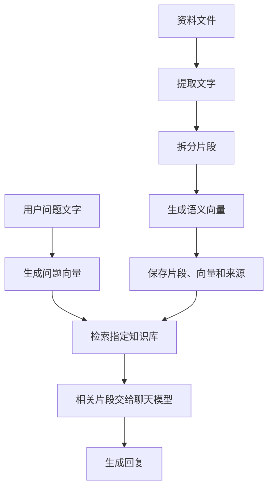

# XiaoZhi.Net.Server RAG

中文 | [English](README_en.md)

RAG 通过“先查资料，再回答”，让小智参考你提供的说明书、常见问题等文字资料。它不会训练或修改聊天模型，而是在模型回答前提供相关片段。

本文介绍模块与接入方式，完整入门说明见 [RAG 文档检索](../../docs/04.rag.md)。

## 模块组成

| 模块或位置 | 职责 |
| --- | --- |
| [RAG.Abstractions](XiaoZhi.Net.Server.RAG.Abstractions) | `IVectorStore`、`IKnowledgeAnalyzer`、`IKnowledgeImportPipeline` 接口及数据模型 |
| [RAG.Documentation](XiaoZhi.Net.Server.RAG.Documentation) | 文件文字提取与导入管线，具体知识分析器由使用方提供 |
| [RAG.Qdrant](XiaoZhi.Net.Server.RAG.Qdrant) | Qdrant 存储实现及注册方法 |
| [示例 RAG 目录](../../demo/XiaoZhi.Net.Sample.Server/RAG) | `KnowledgeBaseBuilder`、`KnowledgeAnalyzer` 和 `InMemoryVectorStore` |
| `XiaoZhi.Net.Server` | `ResourceManager` 注册模型，`DefaultRag` 检索，`ChatAgent` 在回答前接入 `TextSearchProvider` |

服务端运行时只引用 RAG 抽象，不内置示例内存存储，也不直接引用文档解析或 Qdrant 模块。文档解析依赖独立放在 `RAG.Documentation` 中：PDF 使用 PdfPig，DOCX 使用 Open XML，XLSX / CSV 使用 MiniExcel。

## 工作流程



语义向量（Embedding）是一组代表文字含义的数字，用于查找意思接近的内容。导入与查询需要使用同一个 Embedding 模型、同一存储和知识库编号。语音输入先由原有语音识别链路转成文字，回复再由原有语音合成链路播报。

## RAG 配置

示例使用独立的 [config_rag.json](../../demo/XiaoZhi.Net.Sample.Server/Configs/config_rag.json)，随同目录的 `config_*.json` 自动加载。文件提供 `Chatglm` / `Qwen`，默认选择 `Qwen`。以下是只保留一份配置的示例，连接信息均为占位值：

```json
{
  "SelectedSettings": {
    "RAG": "Qwen"
  },
  "ConfiguredSettings": {
    "RAG": {
      "Qwen": {
        "BaseUrl": "https://your-embedding-service.example/v1/",
        "ApiKey": "your-api-key",
        "ModelName": "your-embedding-model",
        "DocumentDirectory": "./document",
        "KnowledgeBaseId": "sample-knowledge-base",
        "TopK": "5"
      }
    }
  }
}
```

核心检索与示例导入器都直接读取 `ConfiguredSettings.RAG` 中选中的配置，无需 `Type` 或 `EmbeddingLLM`。`config_llm.json` 只保存聊天模型，也无需 `Type: chat`；两个类别可以使用同名配置，但模型各自独立。

| 参数 | 默认值 | 用途 |
| --- | --- | --- |
| `SelectedSettings.RAG` | 无 | 选择 RAG 配置名称 |
| `BaseUrl`、`ApiKey`、`ModelName` | 无 | 均需非空，使用支持文本向量生成的 OpenAI 兼容服务 |
| `DocumentDirectory` | 无 | 核心要求目录存在，不会自动导入文件；相对路径基于当前工作目录 |
| `KnowledgeBaseId` | `default` | 查询的知识库编号；当前示例导入固定使用 `sample-knowledge-base` |
| `TopK` | `5` | 最多检索的片段数 |
| `MinimumScore` | 不限制 | 可选最低相似度；配置中可填写字符串形式的数值 |

配置值使用字符串，与当前参数字典一致。更多字段说明见 [配置文件参考](../../docs/00.configuration-file.md)。

> [!NOTE]
> 选中的 RAG 配置存在时，核心会进入初始化，但示例 `Program.cs` 的存储注册和资料导入调用目前被注释。未注册存储或未准备资料目录时，初始化会失败；暂不使用 RAG 时可删除 `SelectedSettings.RAG`。

## 内存示例接入

在 [示例 Program.cs](../../demo/XiaoZhi.Net.Sample.Server/Program.cs) 中引入命名空间，并在现有 `Initialize(config)` 之后、`Build()` 之前启用存储注册：

```csharp
using XiaoZhi.Net.Sample.Server.RAG;

serverBuilder.WithRagVectorStore(KnowledgeBaseBuilder.VectorStore);
```

创建 `document` 目录，放入至少一份非空 TXT 或 Markdown 文件。在现有 `serverHost = serverBuilder.Build();` 之后、运行服务前启用导入：

```csharp
serverHost.BuildKnowledgeBase(config, Path.Combine(Environment.CurrentDirectory, "document"));
await serverHost.RunAsync();
```

此导入会递归读取子目录，并使用示例的同一内存存储。导入路径应与 `DocumentDirectory` 一致，查询编号应为 `sample-knowledge-base`。内存索引在进程退出后消失，每次启动重新导入。

示例 [KnowledgeAnalyzerConfig](../../demo/XiaoZhi.Net.Sample.Server/Configs/KnowledgeAnalyzerConfig.cs) 默认片段长度为 512 字符、目标重叠为 64 字符，每批向量化 16 个片段。这些是示例代码配置，不会自动从 RAG JSON 中读取。

## Qdrant 与自定义存储

引用 `XiaoZhi.Net.Server.RAG.Qdrant`，在 `Build()` 之前注册：

```csharp
using XiaoZhi.Net.Server.RAG.Abstractions;
using XiaoZhi.Net.Server.RAG.Qdrant;

serverBuilder.AddQdrantVectorStore(new QdrantVectorStoreConfig
{
    Host = "localhost",
    Port = 6334,
    UseTls = false,
    CollectionName = "xiaozhi_knowledge"
});
```

`6334` 是默认 gRPC 端口；`ApiKey` 默认不设置，按部署要求提供。索引能否持久保存取决于 Qdrant 的存储部署。当前通过代码选择存储，不支持用 `StoreType` 切换。

此片段只注册存储，不导入或初始化资料。导入端需取得查询侧的同一个 `IVectorStore`，再让知识分析器向它写入；示例 `KnowledgeBaseBuilder` 固定使用内存，不能直接用它为 Qdrant 建库。

**Qdrant 重启主服务后仍需初始化当前存储实例。** 查询前调用 `EnsureInitializedAsync(...)`，传入与模型和集合匹配的向量维度。示例分析器写入新内容时会初始化，但未变化的内容会提前跳过，不能依赖重复导入完成初始化。当前实现不会在已有集合路径中检查集合维度，使用方需确认匹配；切换 Embedding 模型应重建索引。

自定义存储实现 `IVectorStore`，通过 `WithRagVectorStore<TVectorStore>()` 或 `WithRagVectorStore(IVectorStore)` 注册。

## 多格式导入

| 格式 | 示例默认导入 | 独立文档模块 |
| --- | --- | --- |
| `.txt`、`.md`、`.markdown` | 支持 | 支持 |
| `.pdf` | 不支持 | 提取已有文字，不提供扫描件 OCR |
| `.docx` | 不支持 | 提取正文段落文字 |
| `.xlsx`、`.csv` | 不支持 | 提取单元格文字，XLSX 按工作表处理 |

使用多格式导入需额外引用 `XiaoZhi.Net.Server.RAG.Documentation`，并提供使用同一存储的 `IKnowledgeAnalyzer` 实现。该模块当前的注册方法也叫 `AddQdrantVectorStore`，参数为 `IKnowledgeAnalyzer`，位于 `XiaoZhi.Net.Server.RAG.Documentation.Extensions`；此重载注册的是解析器和导入管线，不是 Qdrant 数据库。

注册后通过 `IKnowledgeImportPipeline.ImportFileAsync(...)` 或 `ImportDirectoryAsync(...)` 导入，传入 Embedding 生成器、知识库编号及文件路径参数。目录导入递归处理文件，返回成功、跳过、失败或不支持的结果。旧版 `.doc`、`.xls` 无对应解析器，只有图片的文档需先转换成文字。

## 更新与使用边界

- 示例分析器比较同一来源的内容摘要：未变化时跳过，变化时先写入新片段再清理旧版本。更新不是事务操作，失败后需检查存储状态。
- 当前没有目录自动监控；修改资料后需重新导入，删除原文件不会自动清理索引，需要调用存储删除接口。
- 相似度分数表示相关程度，不是正确率。检索结果有来源信息，但核心不保证每次回复都展示引用或在资料不足时拒答；需要提示词约束与实际验证。
- 使用远程服务时，资料片段和问题会发送给 Embedding 服务，命中片段会提供给聊天模型；调用费用取决于所选服务。

示例和说明按当前代码整理，未执行外部 Embedding、聊天模型与 Qdrant 的端到端验证。
