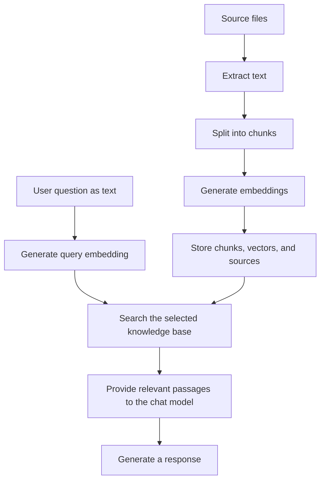

# XiaoZhi.Net.Server RAG

[中文](README.md) | English

RAG lets XiaoZhi consult your manuals, FAQs, and other text before answering. It does not train or modify the chat model; it supplies relevant passages before the model responds.

This page covers the modules and integration steps. For a fuller introduction, see the [RAG guide (Chinese)](../../docs/04.rag.md).

## Modules

| Module or location | Responsibility |
| --- | --- |
| [RAG.Abstractions](XiaoZhi.Net.Server.RAG.Abstractions) | `IVectorStore`, `IKnowledgeAnalyzer`, `IKnowledgeImportPipeline`, and data models |
| [RAG.Documentation](XiaoZhi.Net.Server.RAG.Documentation) | Text extraction and file import pipeline; callers supply the knowledge analyzer |
| [RAG.Qdrant](XiaoZhi.Net.Server.RAG.Qdrant) | Qdrant store implementation and registration method |
| [Sample RAG directory](../../demo/XiaoZhi.Net.Sample.Server/RAG) | `KnowledgeBaseBuilder`, `KnowledgeAnalyzer`, and `InMemoryVectorStore` |
| `XiaoZhi.Net.Server` | `ResourceManager` registers models, `DefaultRag` retrieves passages, and `ChatAgent` attaches a `TextSearchProvider` before answering |

The server runtime references only the RAG abstractions. It does not include the sample in-memory store or directly reference the document parsing or Qdrant modules. Parsing dependencies live in `RAG.Documentation`: PdfPig for PDF, Open XML for DOCX, and MiniExcel for XLSX / CSV.

## How it works



An embedding is a set of numbers representing the meaning of text. It helps find passages with similar meaning. Import and retrieval must use the same embedding model, store, and knowledge-base ID. The existing speech pipeline turns voice input into text and reads the response aloud.

## RAG configuration

The sample uses a separate [config_rag.json](../../demo/XiaoZhi.Net.Sample.Server/Configs/config_rag.json), loaded automatically with the other `config_*.json` fragments in the same directory. It provides `Chatglm` / `Qwen` and selects `Qwen` by default. This example contains one profile; all connection values are placeholders:

```json
{
  "SelectedSettings": {
    "RAG": "Qwen"
  },
  "ConfiguredSettings": {
    "RAG": {
      "Qwen": {
        "BaseUrl": "https://your-embedding-service.example/v1/",
        "ApiKey": "your-api-key",
        "ModelName": "your-embedding-model",
        "DocumentDirectory": "./document",
        "KnowledgeBaseId": "sample-knowledge-base",
        "TopK": "5"
      }
    }
  }
}
```

Both core retrieval and the sample importer read the selected profile directly from `ConfiguredSettings.RAG`. Neither `Type` nor `EmbeddingLLM` is required. `config_llm.json` contains only chat models and no longer needs `Type: chat`. The two categories may use the same profile name, but their models are independent.

| Parameter | Default | Purpose |
| --- | --- | --- |
| `SelectedSettings.RAG` | None | Selects a RAG profile |
| `BaseUrl`, `ApiKey`, `ModelName` | None | All must be nonempty; use an OpenAI-compatible service that generates text embeddings |
| `DocumentDirectory` | None | The core requires an existing directory but does not import files automatically; relative paths use the current working directory |
| `KnowledgeBaseId` | `default` | Knowledge base to search; the current sample importer uses the fixed ID `sample-knowledge-base` |
| `TopK` | `5` | Maximum number of retrieved chunks |
| `MinimumScore` | No threshold | Optional minimum similarity; a numeric value may be supplied as a string |

Values are strings to match the current parameter dictionaries. See the [configuration reference (Chinese)](../../docs/00.configuration-file.md) for more details.

> [!NOTE]
> Selecting an existing RAG profile triggers core initialization, but the sample `Program.cs` still comments out store registration and document import. Initialization fails without a registered store or an existing document directory. Remove `SelectedSettings.RAG` when you do not want to enable RAG yet.

## In-memory sample integration

In the [sample Program.cs](../../demo/XiaoZhi.Net.Sample.Server/Program.cs), add the namespace and enable store registration after the existing `Initialize(config)` call and before `Build()`:

```csharp
using XiaoZhi.Net.Sample.Server.RAG;

serverBuilder.WithRagVectorStore(KnowledgeBaseBuilder.VectorStore);
```

Create a `document` directory containing at least one nonempty TXT or Markdown file. Enable import after the existing `serverHost = serverBuilder.Build();` line and before running the server:

```csharp
serverHost.BuildKnowledgeBase(config, Path.Combine(Environment.CurrentDirectory, "document"));
await serverHost.RunAsync();
```

The importer scans subdirectories recursively and uses the same sample in-memory store. Its input path should match `DocumentDirectory`, and the query ID must be `sample-knowledge-base`. The index disappears when the process exits, so import it again on each startup.

The sample [KnowledgeAnalyzerConfig](../../demo/XiaoZhi.Net.Sample.Server/Configs/KnowledgeAnalyzerConfig.cs) defaults to 512 characters per chunk, a target overlap of 64 characters, and 16 chunks per embedding batch. These settings belong to the sample code and are not read automatically from RAG JSON.

## Qdrant and custom stores

Reference `XiaoZhi.Net.Server.RAG.Qdrant` and register it before `Build()`:

```csharp
using XiaoZhi.Net.Server.RAG.Abstractions;
using XiaoZhi.Net.Server.RAG.Qdrant;

serverBuilder.AddQdrantVectorStore(new QdrantVectorStoreConfig
{
    Host = "localhost",
    Port = 6334,
    UseTls = false,
    CollectionName = "xiaozhi_knowledge"
});
```

`6334` is the default gRPC port. `ApiKey` is unset by default; supply it as required by your deployment. Index persistence depends on how Qdrant storage is deployed. Stores are selected through code; switching with `StoreType` is not supported.

This snippet only registers the store. It does not import or initialize documents. The importer must obtain the same `IVectorStore` used for retrieval and pass it to a knowledge analyzer. The sample `KnowledgeBaseBuilder` always uses memory and cannot directly build a Qdrant knowledge base.

**After restarting the main server, initialize the current Qdrant store instance again.** Before searching, call `EnsureInitializedAsync(...)` with dimensions matching the model and collection. The sample analyzer initializes the store when writing new content, but unchanged content is skipped beforehand, so repeated imports do not guarantee initialization. The current implementation does not check collection dimensions when the collection already exists; callers must verify compatibility. Rebuild the index when changing the embedding model.

For a custom store, implement `IVectorStore` and register it with `WithRagVectorStore<TVectorStore>()` or `WithRagVectorStore(IVectorStore)`.

## Importing other formats

| Format | Default sample importer | Separate document module |
| --- | --- | --- |
| `.txt`, `.md`, `.markdown` | Supported | Supported |
| `.pdf` | Not supported | Extracts existing text; no OCR for scanned documents |
| `.docx` | Not supported | Extracts body paragraph text |
| `.xlsx`, `.csv` | Not supported | Extracts cell text; XLSX is processed by worksheet |

Reference `XiaoZhi.Net.Server.RAG.Documentation` and supply an `IKnowledgeAnalyzer` implementation using the same store. This module's registration method is also currently named `AddQdrantVectorStore`, but takes an `IKnowledgeAnalyzer` and lives in `XiaoZhi.Net.Server.RAG.Documentation.Extensions`. This overload registers parsers and the import pipeline, not a Qdrant database.

After registration, use `IKnowledgeImportPipeline.ImportFileAsync(...)` or `ImportDirectoryAsync(...)`, providing the embedding generator, knowledge-base ID, and required path arguments. Directory import recursively processes files and reports success, skipped, failed, or unsupported results. Legacy `.doc` and `.xls` have no parsers; documents containing only images must first be converted to text.

## Updates and limitations

- The sample analyzer compares content hashes for the same source: unchanged content is skipped, while changed content is written before older chunks are removed. Updates are not transactional; inspect the store after a failure.
- There is no automatic directory monitoring. Reimport edited documents. Deleting a source file does not remove its index entries; use the store's deletion interface.
- Similarity measures relevance, not correctness. Results include source information, but the core does not guarantee citations in every answer or refusal when evidence is insufficient. Use prompt instructions and verify actual responses.
- With remote services, document chunks and questions are sent to the embedding service, and retrieved passages are supplied to the chat model. Costs depend on the services you choose.

The examples describe the current code. External embedding services, chat models, and Qdrant have not been tested end to end for this documentation update.
